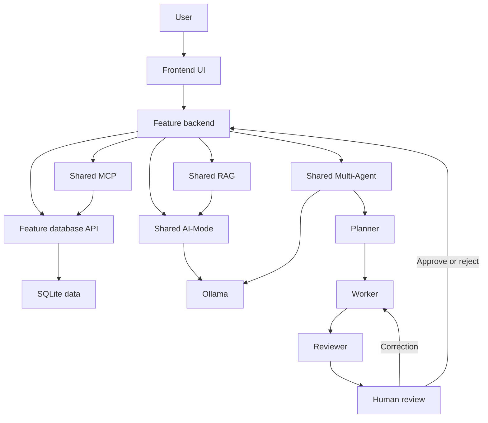
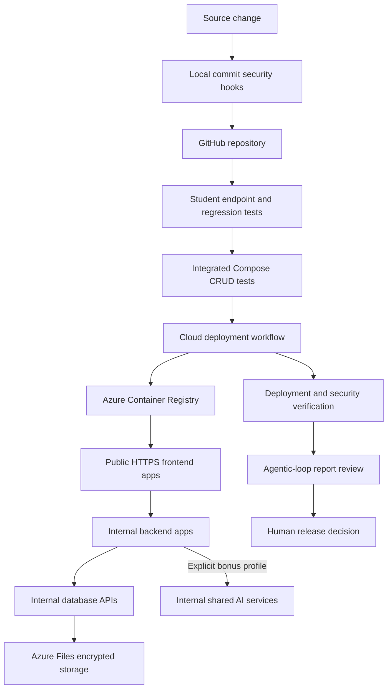

# Release 2 application and deployment architecture

Each feature remains part of the shared login application. The frontend passes the session token to its own backend; the backend validates the token against the internal Finance database API and supplies the authenticated user ID to its database and AI requests. Browser-supplied owner IDs are not trusted.

Planner defines work, required evidence and success criteria. Worker analyses the authenticated feature's supplied database evidence. Reviewer sees that complete plan, evidence, proposal and any correction. The human supplies the final decision; approval does not automatically modify financial records. Coordination events have a run ID, UTC timestamp, stage, model, cycle and output digest. Full proposals and decisions remain in the run/history record.

## Local execution

Core frontend/backend/database services run in Docker Compose. AI-Mode, MCP, RAG, Multi-Agent, Ollama and the shared agentic loop remain separate host processes; backends use `host.docker.internal`. A native HTTP runner is provided for validation where Docker is unavailable; it is identified separately in its evidence and does not substitute for the required Compose demonstration.

## Azure reference architecture and DevOps flow

Azure Container Apps hosts the application. Only the six frontends have external ingress. Backends, database APIs and optional AI services use internal HTTPS ingress. Ingress uses 443; container target ports (3000/5000/6000 etc.) are configuration inside Container Apps and are not appended to ingress URLs. Frontend module/home URLs are deployed public FQDNs.

ACR images are tagged with the source commit, preventing an unchanged `release2` tag from silently serving old code. GitHub authenticates to Azure through OIDC. A user-assigned managed identity pulls ACR images. Runtime keys are generated for the deployment and supplied with Container Apps secret references. SQLite files have persistent Azure Files mounts; the Multi-Agent audit store has a separate share. Storage requires HTTPS/TLS 1.2, disallows anonymous blob access and is checked for Files encryption.

The baseline deployment leaves all four AI feature flags false. The explicit bonus profile deploys Ollama plus AI-Mode, MCP, RAG and Multi-Agent. Local Compose remains unchanged in this respect. These are coursework services; the report should state the tested concurrency and persistence limitations rather than imply production-scale validation.
